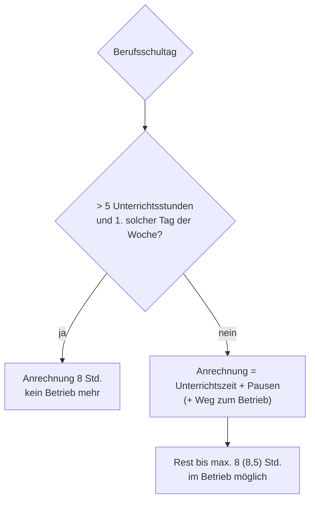

# Berufsschule und Anrechnung auf die Arbeitszeit

> [!summary] Kurz & knapp
> Der Betrieb muss Azubis für die Berufsschule freistellen. Nach **§ 9 JArbSchG** wird **ein** Berufsschultag pro Woche mit **mehr als 5 Unterrichtsstunden** (à 45 Min.) mit **8 Stunden** angerechnet. Alle anderen Berufsschulzeiten werden nur mit der **tatsächlichen Unterrichtszeit einschließlich Pausen** angerechnet.

## Regeln

| Situation | Folge |
|---|---|
| Unterricht beginnt **vor 9:00 Uhr** | Azubi darf **vorher nicht** im Betrieb beschäftigt werden (gilt auch für über 18-Jährige, die noch berufsschulpflichtig sind) |
| **1. Berufsschultag** in der Woche mit **mehr als 5 Unterrichtsstunden** | ganzer Tag frei; Anrechnung mit **8 Stunden** |
| **2. Berufsschultag** (auch wenn > 5 Stunden) | Anrechnung nur mit der **Zeit in der Schule** (Unterricht + Pausen); danach kann der Azubi noch in den Betrieb müssen |
| Berufsschulwochen (Blockunterricht) mit mind. 25 Std. an 5 Tagen | 40 Std. Anrechnung (zusätzliche betriebliche Ausbildung bis 2 Std. möglich) |

> [!warning] Korrektur
> In der Wiederholung vom 11.11.2025 ([[WIPO.pdf#page=29]]) steht: „Vor 9 Uhr an einem Schultag darf man noch im Betrieb arbeiten.“ Das ist **falsch**. Richtig: Beginnt der Unterricht **vor 9 Uhr**, darf der Azubi **vorher nicht** im Betrieb beschäftigt werden.

## Beispiel aus dem Unterricht: Sven (17), Großhandelsklasse

- Fahrtweg Schule ↔ Betrieb: 25 Minuten. Schultage: Montag und Donnerstag.
- **Montag:** 8 Unterrichtsstunden (07:45–14:35) → Sven muss nicht mehr in den Betrieb; der Tag zählt mit **8 Stunden**, obwohl er „nur“ 6 Std. 50 Min. in der Schule war.
- **Donnerstag:** 6 Unterrichtsstunden (07:45–12:50) → zweiter Schultag, Anrechnung nur mit **5 Std. 5 Min.** Nach 25 Min. Fahrtweg kann Sven noch **2,5 Std.** im Betrieb arbeiten (5:05 + 0:25 + 2:30 = 8:00). Pausenregeln beachten!

> [!tip] Merke
> - **Vor 9 Uhr Unterricht → vorher kein Betrieb.**
> - **Einmal pro Woche:** > 5 Unterrichtsstunden = **8 Std.** angerechnet.
> - Zweiter langer Schultag: nur **tatsächliche Schulzeit** (inkl. Pausen) wird angerechnet.

## Lernfragen
> [!question]- Ein Azubi hat montags 6 Unterrichtsstunden. Wie wird der Tag angerechnet?
> Wenn es der erste Tag der Woche mit mehr als 5 Unterrichtsstunden ist, mit 8 Stunden. Der Azubi muss danach nicht mehr in den Betrieb.

> [!question]- Der Unterricht beginnt um 8:30 Uhr. Darf der Azubi vorher noch eine Stunde im Betrieb arbeiten?
> Nein. Beginnt der Unterricht vor 9 Uhr, darf er vorher nicht beschäftigt werden.

> [!question]- Wie wird ein zweiter Berufsschultag mit 4 Unterrichtsstunden (07:45–11:00 Uhr) angerechnet?
> Mit der tatsächlichen Unterrichtszeit einschließlich Pausen, also 3 Stunden 15 Minuten.

> [!question]- Warum darf Sven am Donnerstag nur noch 2,5 Stunden arbeiten?
> 5:05 Std. Schulzeit + 25 Min. Fahrtweg = 5:30 Std. Bis zur täglichen Höchstarbeitszeit von 8 Stunden bleiben 2,5 Stunden.

## Siehe auch
- [[Jugendarbeitsschutzgesetz]]
- [[Arbeitszeit und Pausen nach JArbSchG]]
- [[Übung Julia Wochenplan]]
