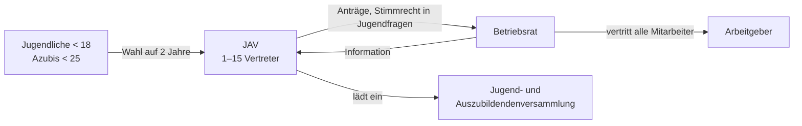

# Jugend- und Auszubildendenvertretung

> [!summary] Kurz & knapp
> Die **Jugend- und Auszubildendenvertretung (JAV)** vertritt im Betrieb die besonderen Interessen der **Jugendlichen unter 18** und der **Azubis unter 25**. Rechtsgrundlage ist das **Betriebsverfassungsgesetz (BetrVG, §§ 60–73b)**. Die JAV ist kein selbstständiges Mitbestimmungsorgan: Sie arbeitet **über den Betriebsrat**, nicht direkt gegenüber dem Arbeitgeber.

## Voraussetzungen

- Im Betrieb existiert ein [[Betriebsrat]] (die JAV ist an ihn gekoppelt).
- Mindestens **5** Arbeitnehmer **unter 18** bzw. Azubis **unter 25** sind beschäftigt (§ 60 BetrVG).
- Größe: **1 bis 15 Mitglieder**, je nach Anzahl der Wahlberechtigten (§ 62 BetrVG):

| Wahlberechtigte | JAV-Mitglieder |
|---|---|
| 5–20 | 1 |
| 21–50 | 3 |
| 51–150 | 5 |
| 151–300 | 7 |
| 301–500 | 9 |
| 501–700 | 11 |
| 701–1000 | 13 |
| mehr als 1000 | 15 |

## Wahl

- **Alle 2 Jahre** im Zeitraum **1. Oktober bis 30. November** (Amtszeit 2 Jahre, beim Betriebsrat 4 Jahre). Eingeleitet wird die Wahl durch den Betriebsrat, der den Wahlvorstand bestellt.
- **Aktives Wahlrecht** (wer darf wählen?): alle Arbeitnehmer **unter 18** und alle **Azubis unter 25** (auch dual Studierende, Praktikanten im Rahmen des Studiums usw.). Maßgeblich ist das Alter am Wahltag.
- **Passives Wahlrecht** (wer darf gewählt werden?): alle **Arbeitnehmer und Azubis unter 25**. Keine Mindestbetriebszugehörigkeit. **Ausnahme:** Betriebsratsmitglieder können nicht in die JAV gewählt werden (§ 61 BetrVG).
- Die Wahl ist unmittelbar und geheim. Ein 20-jähriger Azubi hat ein „Doppelwahlrecht“ (JAV **und** Betriebsrat).

> [!warning] Korrektur
> In der Mitschrift vom 11.11.2025 steht „Aktives Wahlrecht: alle unter 18 + **alle** Azubis; passives Wahlrecht: alle Arbeitnehmer unter 25 + **alle** Azubis“. Richtig ist: Azubis sind nur **unter 25 Jahren** wahlberechtigt und wählbar. Ein 26-jähriger Azubi darf die JAV weder wählen noch in sie gewählt werden.

## Aufgaben (§ 70 BetrVG)

- Maßnahmen beim Betriebsrat **beantragen**, die Jugendlichen/Azubis dienen (v. a. Berufsbildung, Übernahme nach der Ausbildung).
- Maßnahmen zur **Gleichstellung** von Frauen und Männern beantragen.
- **Überwachen**, dass Gesetze, Verordnungen, Unfallverhütungsvorschriften, Tarifverträge und Betriebsvereinbarungen zugunsten der Jugendlichen eingehalten werden.
- **Anregungen und Beschwerden** entgegennehmen und an den Betriebsrat weitergeben; die Betroffenen über das Ergebnis informieren.
- **Integration** ausländischer Jugendlicher und Azubis fördern.
- Der Betriebsrat muss die JAV **rechtzeitig und umfassend** informieren und erforderliche Unterlagen zur Verfügung stellen.

## Rechte

- Rechte bestehen **gegenüber dem Betriebsrat, nicht gegenüber dem Arbeitgeber** (sonst würde die Belegschaft gespalten).
- Die JAV kann zu **allen Betriebsratssitzungen einen Vertreter** entsenden.
- Bei Themen, die **besonders Jugendliche/Azubis** betreffen, darf die **gesamte JAV** teilnehmen; bei Themen, die **überwiegend** sie betreffen, hat die JAV **volles Stimmrecht**.
- Sie kann verlangen, dass Jugendthemen auf die Tagesordnung kommen, und einen BR-Beschluss für **eine Woche aussetzen** lassen, wenn wichtige Azubi-Interessen beeinträchtigt sind (§ 66 BetrVG).
- Interne Organisation: Geschäftsordnung, Sitzungen, bis zu **4 Jugend- und Auszubildendenversammlungen** pro Jahr, **Sprechstunden** in Betrieben mit mehr als 50 Jugendlichen/Azubis (§ 69 BetrVG), Schulungen; der Arbeitgeber trägt die Kosten und stellt Sachmittel.

## Kündigungsschutz und Übernahme

- JAV-Mitglieder genießen wie Betriebsräte besonderen **Kündigungsschutz** (Zustimmung des Betriebsrats nötig, § 103 BetrVG).
- **Übernahmeanspruch (§ 78a BetrVG):** Verlangt ein JAV-Mitglied in den **letzten 3 Monaten** vor Ausbildungsende **schriftlich** die Weiterbeschäftigung, entsteht ein unbefristetes Arbeitsverhältnis. Der Arbeitgeber kann sich nur über das Arbeitsgericht davon lösen (Antrag spätestens 2 Wochen nach Ausbildungsende).
- Sie sind aber **nicht generell unkündbar**.

> [!tip] Merke
> - Gesetz: **BetrVG**; Aufgaben: **§ 70 BetrVG**.
> - Wahl **alle 2 Jahre** (1.10.–30.11.), Größe **1–15**.
> - Wählen: **unter 18** und **Azubis unter 25**; wählbar: **alle unter 25**, außer BR-Mitglieder.
> - Ansprechpartner der JAV ist immer der **Betriebsrat**.
> - Schutz: Kündigungsschutz + **Übernahmeanspruch** (schriftlich in den letzten 3 Monaten).

## Lernfragen
> [!question]- In welchem Gesetz ist die JAV geregelt?
> Im Betriebsverfassungsgesetz (BetrVG, §§ 60–73b).

> [!question]- Wer darf die JAV wählen und wer darf gewählt werden?
> Wählen dürfen alle Arbeitnehmer unter 18 und alle Azubis unter 25. Gewählt werden können alle Arbeitnehmer und Azubis unter 25, die nicht Mitglied des Betriebsrats sind.

> [!question]- Wie lange dauert die Amtszeit der JAV und warum ist sie kürzer als die des Betriebsrats?
> 2 Jahre (BR: 4 Jahre). So können Jugendliche vor ihrem 18. Geburtstag bzw. vor dem Ausbildungsende an einer Wahl teilnehmen.

> [!question]- Kann die JAV direkt mit dem Arbeitgeber verhandeln?
> Nein. Ihr Ansprechpartner ist der Betriebsrat; sie stellt dort Anträge und hat in Jugendfragen Stimmrecht.

> [!question]- Welchen besonderen Schutz haben JAV-Mitglieder?
> Kündigungsschutz (Zustimmung des BR nötig) und Anspruch auf Übernahme in ein unbefristetes Arbeitsverhältnis, wenn sie dies in den letzten 3 Monaten vor Ausbildungsende schriftlich verlangen.

> [!question]- Nenne drei Aufgaben der JAV.
> Z. B. Maßnahmen zur Berufsbildung beim BR beantragen, die Einhaltung von Schutzvorschriften überwachen, Beschwerden weitergeben, Gleichstellung und Integration fördern.

## Siehe auch
- [[Betriebsrat]]
- [[Übung JAV - Aufgaben und Praxisfall]]
- [[Rechte und Pflichten des Auszubildenden]]
