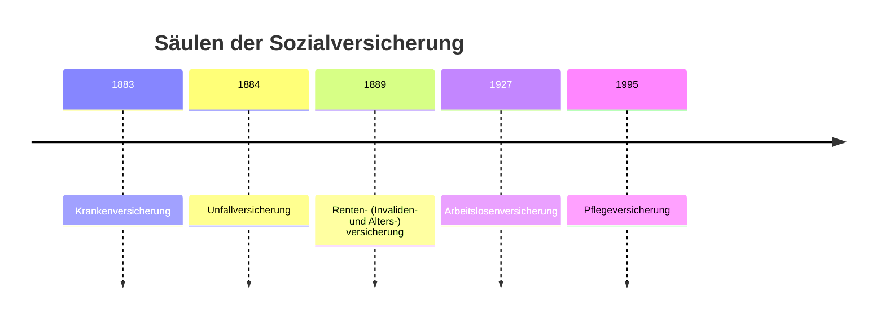

# Entwicklung der sozialen Sicherung

> [!summary] Kurz & knapp
> Die deutsche Sozialversicherung entstand im 19. Jahrhundert als Antwort auf die Not der Arbeiter in der Industrialisierung. Reichskanzler **Otto von Bismarck** gilt als Begründer der Sozialgesetzgebung: **1883 Kranken-, 1884 Unfall-, 1889 Invaliden- und Altersversicherung**. Ein Motiv war, der Sozialdemokratie und einer möglichen Revolution vorzubeugen.

## Hintergrund

- Die **industrielle Revolution** schafft die Klasse der Arbeiter. Sie und ihre Familien sind bei Krankheit, Unfall und im Alter nicht abgesichert.
- Soziale Unruhen und der Druck der Arbeiterbewegung zwingen die Politik zu handeln.
- Kaiser Wilhelm I. (1881) und Bismarck (1889) wollten die Arbeiter durch „positive Förderung“ an den Staat binden – nicht nur durch Unterdrückung der Sozialdemokratie.

## Zeitstrahl (Auswahl)

| Jahr | Ereignis |
|---|---|
| 1883 | Krankenversicherungsgesetz für Arbeiter |
| 1884 | Unfallversicherungsgesetz |
| 1889 | Invaliden- und Altersversicherung |
| 1911 | Reichsversicherungsordnung (RVO) |
| 1927 | Arbeitslosenversicherung und Arbeitsvermittlung |
| 1952 | Mutterschutzgesetz |
| 1957 | bruttolohnbezogene, dynamische Rente |
| 1976 | Novelle des Jugendarbeitsschutzgesetzes |
| 1995 | Gesetzliche Pflegeversicherung (5. Säule) |
| 2003 | „Hartz“-Gesetze zum Arbeitsmarkt |
| 2009 | Gesundheitsfonds der Krankenversicherung |
| 2012 | schrittweise Einführung der „Rente mit 67“ |

> [!tip] Merke
> - Begründer: **Bismarck** (1880er Jahre).
> - Reihenfolge der Säulen: **KV 1883 – UV 1884 – RV 1889 – AV 1927 – PV 1995**.
> - Die Pflegeversicherung ist die jüngste Säule.

## Lernfragen
> [!question]- Warum führte Bismarck die Sozialversicherung ein?
> Um die Not der Arbeiter zu lindern und sie an den Staat zu binden. So wollte er dem Einfluss der Sozialdemokratie und einer möglichen Revolution vorbeugen.

> [!question]- In welcher Reihenfolge entstanden die fünf Säulen?
> Kranken- (1883), Unfall- (1884), Renten- (1889), Arbeitslosen- (1927), Pflegeversicherung (1995).

> [!question]- Welche gesellschaftliche Entwicklung machte eine Sozialversicherung nötig?
> Die Industrialisierung. Aus einer bäuerlich-handwerklichen Gesellschaft wurde eine Industriegesellschaft mit abhängigen Arbeitern ohne soziale Absicherung.

## Siehe auch
- [[Gesetzliche Sozialversicherung]]
- [[Prinzipien der sozialen Sicherung]]
