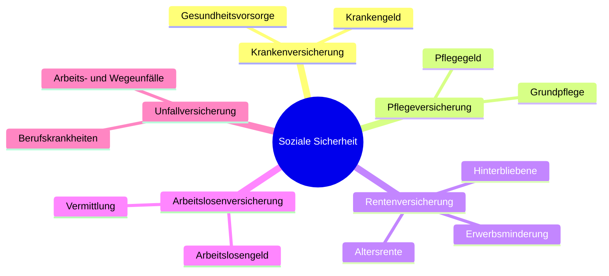

# Gesetzliche Sozialversicherung

> [!summary] Kurz & knapp
> Die gesetzliche Sozialversicherung besteht aus **fünf Zweigen**: Kranken-, Pflege-, Renten-, Arbeitslosen- und Unfallversicherung. Arbeitgeber und Arbeitnehmer zahlen die Beiträge grundsätzlich **je zur Hälfte**; die **Unfallversicherung** zahlt der **Arbeitgeber allein**. Die Beiträge richten sich nach dem Bruttolohn, aber nur bis zur **Beitragsbemessungsgrenze**.

## Die fünf Säulen (Werte 2026, Stand 15.11.2025)

| | Kranken-V. (KV) | Pflege-V. (PV) | Renten-V. (RV) | Arbeitslosen-V. (AV) | Unfall-V. (UV) |
|---|---|---|---|---|---|
| **Träger** | Krankenkassen (AOK, IKK, BKK, Ersatzkassen) über den Gesundheitsfonds | Pflegekassen bei den Krankenkassen | Deutsche Rentenversicherung (Bund) | Bundesagentur für Arbeit (Nürnberg) | Berufsgenossenschaften |
| **Beitragssatz** | 14,6 % + Ø Zusatzbeitrag 2,9 % | 3,6 % (Kinderlose ab 23: 4,2 %) | 18,6 % | 2,6 % | nach Lohnsumme und Gefahrklasse |
| **Anteil AG** | 7,3 % + ½ Zusatzbeitrag | 1,8 % (Sachsen 1,3 %) | 9,3 % | 1,3 % | **allein** |
| **Anteil AN** | 7,3 % + ½ Zusatzbeitrag | 1,8 % (+ 0,6 % Kinderlosenzuschlag = 2,4 %) | 9,3 % | 1,3 % | 0 % |
| **BBG jährlich / monatlich** | 69.750 € / 5.812,50 € | wie KV | 101.400 € / 8.450 € | wie RV | – |
| **Leistungen** | Krankenhilfe, Arzt- und Arzneikosten, **Krankengeld**, Vorsorgeuntersuchungen, Mutterschafts- und Familienhilfe | Pflegegeld, häusliche und stationäre Pflege, Pflegehilfsmittel | Altersrente, Erwerbsminderungsrente, Hinterbliebenenrente (Witwen, Waisen), Reha | Arbeitslosengeld, Kurzarbeitergeld, Insolvenzgeld, Arbeitsvermittlung, Berufsberatung, Umschulung | Heilbehandlung nach Arbeits- und **Wegeunfällen**, Verletztengeld, Umschulung, Renten, Unfallverhütung |

![[WIPO.pdf#page=46]]

## Wichtige Grenzen 2026

| Begriff | Wert | Bedeutung |
|---|---|---|
| **Beitragsbemessungsgrenze (BBG)** | KV/PV 5.812,50 €/Monat; RV/AV 8.450 €/Monat | Einkommen oberhalb der Grenze ist beitragsfrei → Beitrag bleibt konstant |
| **Versicherungspflichtgrenze** KV/PV | 6.450 €/Monat (77.400 €/Jahr) | Wer mehr verdient, darf sich privat krankenversichern |
| **Geringverdienergrenze für Azubis** | 325 €/Monat | Bis zu dieser Vergütung zahlt der **Arbeitgeber die Beiträge allein** |
| **Minijob-Grenze** | 603 €/Monat | geringfügige Beschäftigung |
| **Mindestlohn** | 13,90 €/Std. | |

## Leistungen im Detail

- **Krankengeld:** ab der **7. Woche** der Arbeitsunfähigkeit (vorher 6 Wochen Lohnfortzahlung durch den Arbeitgeber); 70 % des Bruttolohns, höchstens 90 % des Nettolohns.
- **Arbeitslosengeld:** grundsätzlich bis **12 Monate** (Voraussetzung: mind. 24 Monate versichert); bei nur 12 Monaten Versicherung: 6 Monate. Ältere länger: ab 50 Jahren max. 15, ab 55 max. 18, ab 58 max. 24 Monate.
- **Grundsicherung** ist **keine** Leistung der Arbeitslosenversicherung, sondern **steuerfinanziert** → [[Prinzipien der sozialen Sicherung]].

> [!tip] Merke
> - **5 Zweige:** KV, PV, RV, AV, UV.
> - **AG und AN je ½** – Ausnahme **UV: AG allein**; Kinderlosenzuschlag PV (0,6 %) zahlt der AN allein.
> - RV **18,6 %**, AV **2,6 %**, KV **14,6 % + Zusatzbeitrag**, PV **3,6 %** (kinderlos 4,2 %).
> - Oberhalb der **Beitragsbemessungsgrenze** steigt der Beitrag nicht mehr.
> - Azubis unter **325 €** Vergütung: AG zahlt alles.

## Lernfragen
> [!question]- Nenne die fünf Zweige der Sozialversicherung und ihre Träger.
> KV (Krankenkassen), PV (Pflegekassen), RV (Deutsche Rentenversicherung), AV (Bundesagentur für Arbeit), UV (Berufsgenossenschaften).

> [!question]- Welche Versicherung zahlt der Arbeitgeber allein und warum?
> Die Unfallversicherung. Sie ersetzt die Haftung des Arbeitgebers für Arbeits- und Wegeunfälle.

> [!question]- Was ist die Beitragsbemessungsgrenze?
> Die Einkommensgrenze, bis zu der Beiträge berechnet werden. Einkommen darüber ist beitragsfrei, der Beitrag bleibt also konstant.

> [!question]- Ein 24-jähriger kinderloser Azubi: Wie hoch ist sein Anteil an der Pflegeversicherung?
> 1,8 % + 0,6 % Kinderlosenzuschlag = 2,4 % (der Zuschlag gilt ab 23 Jahren).

> [!question]- Ab wann zahlt die Krankenkasse Krankengeld?
> Ab der 7. Woche der Arbeitsunfähigkeit; in den ersten 6 Wochen zahlt der Arbeitgeber den Lohn weiter.

> [!question]- Wie lange erhält eine 30-Jährige, die 3 Jahre versichert war, Arbeitslosengeld?
> Grundsätzlich bis zu 12 Monate.

## Siehe auch
- [[Prinzipien der sozialen Sicherung]]
- [[Gehaltsabrechnung]]
- [[Entwicklung der sozialen Sicherung]]
- [[Übung Sozialstaat und Sozialversicherung]]
- [[Übung Sozialversicherungen Tabelle]]
