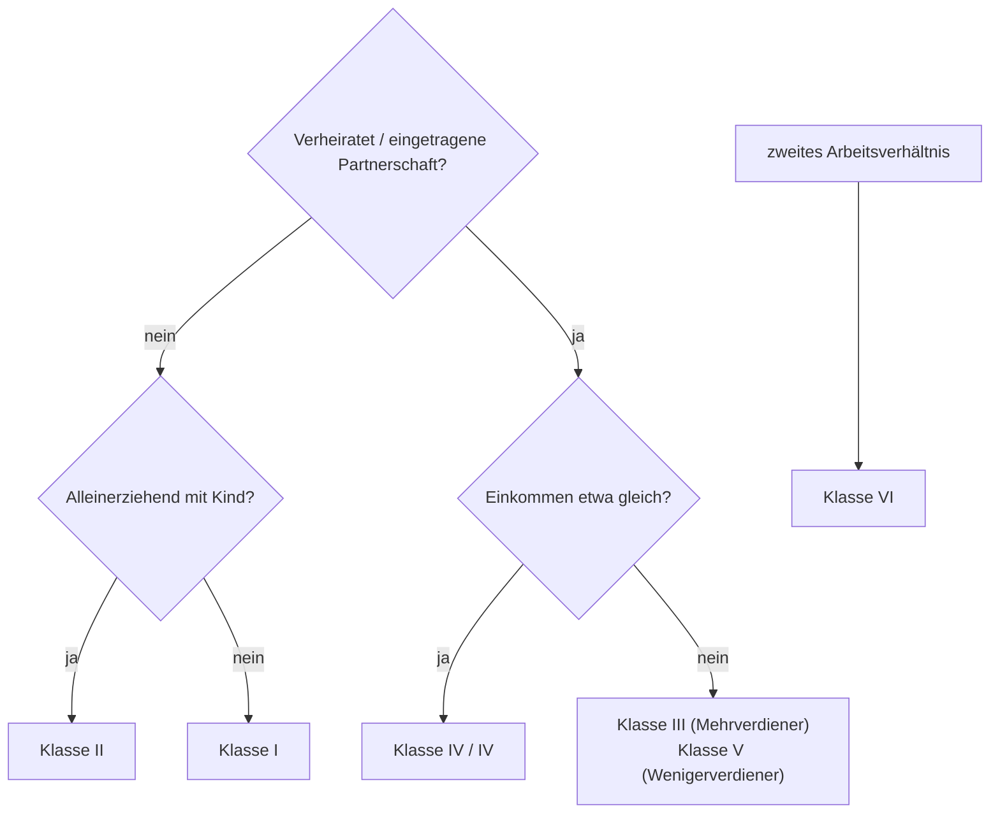

# Lohnsteuerklassen

> [!summary] Kurz & knapp
> Die **Lohnsteuer** ist die Einkommensteuer auf Arbeitslohn; der Arbeitgeber zieht sie direkt vom Gehalt ab und führt sie ans Finanzamt ab. Wie hoch der monatliche Abzug ist, hängt u. a. von der **Steuerklasse (I–VI)** ab, die sich nach dem **Familienstand** richtet.

## Übersicht

| Klasse | Für wen? | Hinweis |
|---|---|---|
| **I** | Ledige, Geschiedene, Verwitwete, dauerhaft getrennt Lebende (ohne Kinder oder mit erwachsenen Kindern) | „Singles“ – typisch für Azubis |
| **II** | **Alleinerziehende** mit mind. einem Kind im Haushalt, für das sie Kindergeld bekommen | Vorteil: zusätzlicher **Entlastungsbetrag** |
| **III** | Verheiratete/eingetragene Lebenspartner mit **unterschiedlich hohem** Einkommen – für den Partner, der **mehr verdient** | Der andere Partner erhält automatisch **Klasse V** |
| **IV** | Verheiratete/eingetragene Lebenspartner, die **etwa gleich viel** verdienen | |
| **V** | Verheiratete/eingetragene Lebenspartner – für den Partner, der **weniger verdient** | Kombination III/V |
| **VI** | Arbeitnehmer mit **mehreren** steuer- und sozialversicherungspflichtigen **Arbeitsverhältnissen** (für den Zweitjob) | höchster Abzug |

## Weitere Steuerabzüge

- **Kirchensteuer:** 8 % der Lohnsteuer in Baden-Württemberg und Bayern, in allen anderen Bundesländern **9 %** (nur für Kirchenmitglieder).
- **Solidaritätszuschlag:** wird heute nur noch bei hohen Einkommen erhoben.

> [!tip] Merke
> - I = ledig, II = alleinerziehend, III/V = verheiratet mit unterschiedlichem Einkommen, IV/IV = verheiratet mit gleichem Einkommen, VI = Zweitjob.
> - Kirchensteuer **8 % (BW, BY) / 9 %** der Lohnsteuer.

## Lernfragen
> [!question]- Welche Steuerklasse hat ein lediger Azubi ohne Kinder?
> Steuerklasse I.

> [!question]- Ein Ehepaar: Sie verdient 4.000 €, er 1.500 €. Welche Kombination lohnt sich monatlich meist?
> III für sie (Mehrverdienerin), V für ihn.

> [!question]- Wofür gibt es die Steuerklasse VI?
> Für das zweite (und jedes weitere) Arbeitsverhältnis.

> [!question]- Wie hoch ist die Kirchensteuer in Schleswig-Holstein?
> 9 % der Lohnsteuer.

## Siehe auch
- [[Gehaltsabrechnung]]
- [[Gesetzliche Sozialversicherung]]
