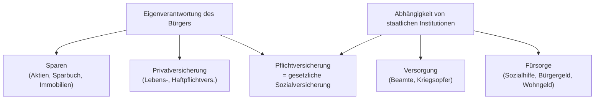

# Prinzipien der sozialen Sicherung

> [!summary] Kurz & knapp
> Deutschland ist ein **Sozialstaat**. Die soziale Sicherung beruht auf drei Prinzipien: dem **Versicherungsprinzip** (Leistung gegen Beitrag), dem **Versorgungsprinzip** (Leistung für besondere Dienste/Opfer, aus Steuern) und dem **Fürsorgeprinzip** (Hilfe bei Bedürftigkeit, aus Steuern, nachrangig = Subsidiarität).

## Die drei Prinzipien

| | Versicherungsprinzip | Versorgungsprinzip | Fürsorgeprinzip |
|---|---|---|---|
| **Idee** | Solidarität: „Einer für alle, alle für einen“; Risiken auf viele Schultern verteilen | Entschädigung durch die Gemeinschaft für besondere Dienste oder Opfer | Hilfe nur, wenn keine andere Absicherung greift (**Subsidiarität**) |
| **Anspruch durch** | eigene **Beitragszahlung** | besondere Dienste/Opfer, **ohne eigene Beiträge** | **Bedürftigkeit** |
| **Finanzierung** | Beiträge (AG + AN) | **Steuern** | **Steuern** |
| **Leistungshöhe** | meist einkommensabhängig | gesetzlich festgelegt | nach Bedarf (Existenzminimum) |
| **Beispiele** | Kranken-, Renten-, Arbeitslosen-, Pflege-, Unfallversicherung | Beamtenversorgung, Kriegsopferversorgung | Bürgergeld (früher ALG II), Sozialhilfe, Wohngeld |

**Grundsatz:** Jeder Bürger muss zunächst **eigenverantwortlich** für sich sorgen; erst wenn er das nicht mehr kann, greift die Gemeinschaft ein.

## Grundprinzipien der Sozialversicherung

- **Versicherungspflicht:** Wer arbeitet oder eine Ausbildung macht, ist in der Regel automatisch versichert (ca. 90 % der Bevölkerung).
- **Beitragsfinanzierung:** Arbeitgeber und Arbeitnehmer teilen sich die Beiträge, die Höhe richtet sich nach dem Bruttolohn (Unfallversicherung: AG allein).
- **Solidarität:** Wer viel verdient, zahlt mehr; die Stärkeren unterstützen die Schwächeren.
- **Äquivalenz:** Die Höhe der Leistung richtet sich nach Höhe und Dauer der Einzahlungen – gilt bei Rente, Arbeitslosengeld, Krankengeld, Unfallversicherung. Bei der **Krankenbehandlung** gilt sie **nicht**: Alle Versicherten bekommen die gleiche medizinische Leistung.

## Staatliche Förder- und Fürsorgeleistungen (steuerfinanziert)

- **Bürgergeld** (bis 2022 „Arbeitslosengeld II / Hartz IV“) für erwerbsfähige Bedürftige.
- **Sozialhilfe** und **Grundsicherung im Alter** für nicht Erwerbsfähige.
- **Elterngeld** → [[Elterngeld und Elternzeit]].
- **Kindergeld:** bis 18, für arbeitssuchende Kinder bis 21, in Ausbildung/Studium bis 25.
- **BAföG** (Ausbildungsförderung) abhängig vom Einkommen der Eltern.

> [!warning] Korrektur
> In den Materialien heißt die Leistung noch „Arbeitslosengeld II (Hartz IV)“. Seit dem **1.1.2023** heißt sie **Bürgergeld**.

> [!tip] Merke
> - **Versicherung:** Beitrag → Anspruch (Solidarität).
> - **Versorgung:** besondere Dienste/Opfer → Steuern.
> - **Fürsorge:** Bedürftigkeit → Steuern, **nachrangig** (Subsidiarität).
> - Äquivalenz bei Geldleistungen ja, bei der Krankenbehandlung nein.

## Lernfragen
> [!question]- Worin unterscheiden sich Versicherungs- und Fürsorgeprinzip?
> Beim Versicherungsprinzip entsteht der Anspruch durch eigene Beiträge. Beim Fürsorgeprinzip entsteht er durch Bedürftigkeit, wird aus Steuern bezahlt und greift nur nachrangig.

> [!question]- Was bedeutet Subsidiarität?
> Der Staat hilft nur, wenn sich der Einzelne oder die Familie nicht selbst helfen kann.

> [!question]- Ordne zu: Beamtenpension, Wohngeld, Altersrente.
> Beamtenpension → Versorgungsprinzip; Wohngeld → Fürsorgeprinzip; Altersrente → Versicherungsprinzip.

> [!question]- Was besagt das Äquivalenzprinzip und wo gilt es nicht?
> Die Leistung entspricht der Höhe und Dauer der Beiträge (z. B. Rente). Bei der Krankenbehandlung gilt es nicht, denn alle Versicherten bekommen dieselbe Behandlung.

> [!question]- Wie zeigt sich Solidarität in der Sozialversicherung?
> Beiträge richten sich nach dem Einkommen, Leistungen (z. B. Krankenbehandlung) bekommt jeder nach Bedarf. Gutverdienende unterstützen so Geringverdienende, Gesunde die Kranken.

## Siehe auch
- [[Gesetzliche Sozialversicherung]]
- [[Entwicklung der sozialen Sicherung]]
- [[Elterngeld und Elternzeit]]
- [[Übung Sozialstaat und Sozialversicherung]]
