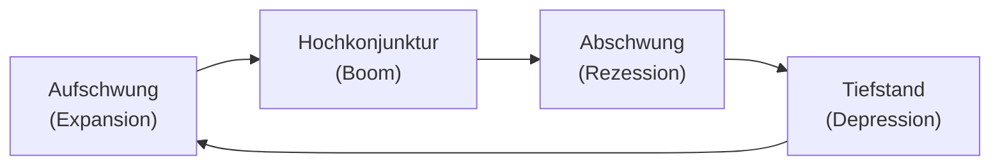

# Konjunkturentwicklung in Deutschland

> [!summary] Kurz & knapp
> Die wirtschaftliche Entwicklung verläuft in **Schwankungen** (Konjunktur). Man misst sie v. a. am **Wirtschaftswachstum** (Veränderung des realen BIP), an der Zahl der **Erwerbstätigen** und an den **Verbraucherpreisen** (Inflation). Typische Einbrüche gab es 1966/67, 1975, 1993, 2009 (Finanzkrise) und 2020 (Corona).

## Die Grafik „Das Auf und Ab der Wirtschaft“

![[WIPO.pdf#page=71]]

| Indikator | Was wird gemessen? | Auffälligkeiten |
|---|---|---|
| **Wirtschaftswachstum** | Veränderung des **realen Bruttoinlandsprodukts** gegenüber dem Vorjahr in % | 1950er: sehr hohes Wachstum (bis 12 %, „Wirtschaftswunder“); Tendenz langfristig **fallend**; Einbrüche u. a. **1967: −0,3 %**, 2009: −5,6 %, 2020 (Corona) rund −4 % |
| **Erwerbstätige** | Veränderung der Zahl der Erwerbstätigen in % | **1967: −3,3 %** (stärkster Rückgang der Grafik) |
| **Verbraucherpreise** | Veränderung der Lebenshaltungskosten (Inflationsrate) in % | 1966: 3,8 % → 1967: 1,3 %; Hochinflation in den 1970ern (bis 7 %); seit 2020 stark gestiegen (Preisniveau 2026 ca. **25 % über 2020**) |

## Situation 1966/67

- **Erste Rezession** der Bundesrepublik: Die Wirtschaft schrumpfte erstmals (−0,3 %).
- Die Zahl der Erwerbstätigen sank deutlich (−3,3 %), die Arbeitslosigkeit stieg.
- Die Inflation war vorher relativ hoch (3,8 %) und ging dann zurück.
- Folge: das **Stabilitäts- und Wachstumsgesetz 1967** → [[Magisches Viereck der Wirtschaftspolitik]].

## Konjunkturphasen

- **Rezession:** Die Wirtschaftsleistung geht zurück (meist: BIP sinkt in zwei Quartalen in Folge).
- Der Staat kann nach Keynes **antizyklisch** gegensteuern: in der Krise mehr ausgeben, im Boom sparen.

> [!tip] Merke
> - Konjunkturindikatoren: **BIP-Wachstum, Erwerbstätige/Arbeitslosenquote, Verbraucherpreise**.
> - **1966/67: erste Rezession** → StabG 1967.
> - Das Wachstum ist seit den 1950ern langfristig gesunken; große Einbrüche **2009** und **2020**.

## Lernfragen
> [!question]- Mit welchen Kennzahlen beschreibt man die Konjunktur?
> Mit dem Wachstum des realen BIP, der Veränderung der Erwerbstätigen bzw. der Arbeitslosenquote und der Veränderung der Verbraucherpreise (Inflationsrate).

> [!question]- Beschreibe die Lage der deutschen Wirtschaft 1966/67.
> Erste Rezession: Das BIP sank um 0,3 %, die Zahl der Erwerbstätigen um 3,3 %, die Arbeitslosigkeit stieg. Die Preissteigerung ging von 3,8 % auf 1,3 % zurück.

> [!question]- Was ist der Unterschied zwischen nominalem und realem BIP?
> Das reale BIP ist um Preissteigerungen bereinigt und zeigt so das tatsächliche Mengenwachstum.

> [!question]- Wie hat sich das Preisniveau seit 2020 entwickelt?
> Es ist stark gestiegen. Laut Destatis lagen die Verbraucherpreise 2026 rund 25 % über dem Niveau von 2020 (Energiekrise, Ukraine-Krieg).

## Siehe auch
- [[Magisches Viereck der Wirtschaftspolitik]]
- [[Übung Konjunktur 1966-67 und heute]]
