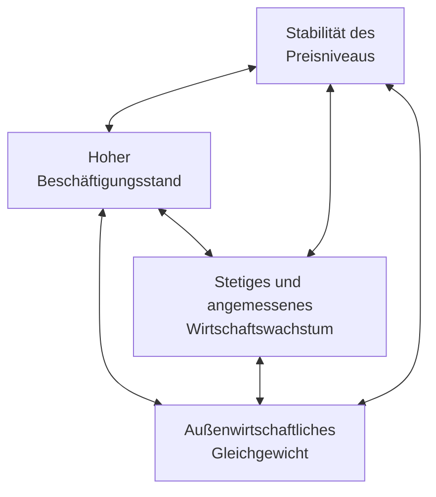

# Magisches Viereck der Wirtschaftspolitik

> [!summary] Kurz & knapp
> Das **Stabilitäts- und Wachstumsgesetz (StabG) von 1967** verpflichtet Bund und Länder in **§ 1**, auf das **gesamtwirtschaftliche Gleichgewicht** zu achten. Dazu gehören vier Ziele: **Preisniveaustabilität**, **hoher Beschäftigungsstand**, **außenwirtschaftliches Gleichgewicht** und **stetiges, angemessenes Wirtschaftswachstum**. „Magisch“ heißt das Viereck, weil sich die Ziele wegen **Zielkonflikten** kaum gleichzeitig erreichen lassen.

## § 1 StabG (Wortlaut)

> Bund und Länder haben bei ihren wirtschafts- und finanzpolitischen Maßnahmen die Erfordernisse des gesamtwirtschaftlichen Gleichgewichts zu beachten. Die Maßnahmen sind so zu treffen, dass sie im Rahmen der marktwirtschaftlichen Ordnung gleichzeitig zur Stabilität des Preisniveaus, zu einem hohen Beschäftigungsstand und außenwirtschaftlichem Gleichgewicht bei stetigem und angemessenem Wirtschaftswachstum beitragen.

## Die vier Ziele

| Ziel | Bedeutung | Messgröße (Indikator) |
|---|---|---|
| **Preisniveaustabilität** | kaum Inflation; Geld behält seinen Wert | Verbraucherpreisindex (Ziel der EZB: ca. 2 % Inflation) |
| **Hoher Beschäftigungsstand** | möglichst wenig Arbeitslosigkeit | Arbeitslosenquote |
| **Außenwirtschaftliches Gleichgewicht** | ausgeglichene Beziehungen zum Ausland (Exporte ≈ Importe) | Außenbeitrag / Leistungsbilanz |
| **Stetiges, angemessenes Wirtschaftswachstum** | gleichmäßiges Wachstum ohne starke Schwankungen | Veränderung des realen BIP |

## Entstehungsgeschichte des StabG

- 1966/67 erlebte die junge Bundesrepublik ihre **erste Rezession**: Das Bruttosozialprodukt schrumpfte, die Arbeitslosigkeit stieg.
- Kanzler Ludwig Erhard wurde gestürzt; eine **Große Koalition** unter Kurt Georg Kiesinger übernahm. Wirtschaftsminister **Karl Schiller** (SPD) und Finanzminister **Franz Josef Strauß** (CSU) sollten Krise und Arbeitslosigkeit mit neuen Methoden bekämpfen.
- Schillers „Meisterstück“ war das **Gesetz zur Förderung der Stabilität und des Wachstums der Wirtschaft** (verkündet im Juni 1967). Es legte den **Keynesianismus** rechtlich fest.
- **Keynesianismus** (nach John Maynard Keynes): In der Krise soll der Staat mit schuldenfinanzierten Investitionen (z. B. Infrastruktur) Nachfrage und Beschäftigung schaffen. Im Aufschwung soll er sich zurückhalten und die Schulden über Steuereinnahmen wieder abbauen (**antizyklische Fiskalpolitik**).
- Schiller nannte das Gesetz eine „Synthese zwischen Freiburger Imperativ und keynesianischer Botschaft“: Die Marktwirtschaft hat Vorrang, wird aber vom Staat stabilisiert.

## Grenzen durch „im Rahmen der marktwirtschaftlichen Ordnung“

- Der Staat darf **nicht planwirtschaftlich** eingreifen: keine staatlich festgesetzten Preise und Löhne, keine Produktionsvorgaben für Unternehmen.
- Preise bilden sich am **Markt**; Löhne handeln die Tarifparteien aus (**Tarifautonomie**); Eigentum und Vertragsfreiheit bleiben geschützt.
- Der Staat kann nur **indirekt** steuern: über Steuern, Staatsausgaben, Investitionen, Subventionen und Anreize. Die Geldpolitik liegt heute bei der **EZB**.

## Zielkonflikte (warum „magisch“?)

- **Preisstabilität ↔ hohe Beschäftigung:** Mehr Nachfrage schafft Arbeitsplätze, kann aber die Preise steigen lassen.
- **Wachstum ↔ Preisstabilität:** Ein starker Aufschwung kann die Wirtschaft „überhitzen“ (Inflation).
- **Wachstum ↔ außenwirtschaftliches Gleichgewicht:** Hohe Exportüberschüsse fördern das Wachstum, verletzen aber das Gleichgewicht.
- Ergänzung: Oft wird das Viereck zum „magischen Sechseck“ erweitert (gerechte Einkommens- und Vermögensverteilung, Umweltschutz); diese Ziele stehen nicht im StabG.

> [!tip] Merke
> - **StabG 1967, § 1** – vier Ziele: **Preisstabilität, hohe Beschäftigung, außenwirtschaftliches Gleichgewicht, stetiges Wachstum**.
> - Anlass: **Rezession 1966/67**; Idee: **Keynesianismus** (antizyklisch gegensteuern).
> - „Magisch“ wegen **Zielkonflikten**.
> - Grenze: nur **marktkonforme**, indirekte Eingriffe.

## Lernfragen
> [!question]- Nenne die vier Ziele des magischen Vierecks.
> Stabilität des Preisniveaus, hoher Beschäftigungsstand, außenwirtschaftliches Gleichgewicht, stetiges und angemessenes Wirtschaftswachstum.

> [!question]- Warum spricht man von einem „magischen“ Viereck?
> Weil die Ziele sich gegenseitig behindern (Zielkonflikte) und kaum alle gleichzeitig erreicht werden können.

> [!question]- Warum wurde 1967 das Stabilitäts- und Wachstumsgesetz beschlossen?
> Wegen der ersten Rezession der Bundesrepublik 1966/67 mit schrumpfender Wirtschaft und steigender Arbeitslosigkeit. Der Staat sollte aktiv gegensteuern können (Keynesianismus).

> [!question]- Welche Grenzen setzt der Zusatz „im Rahmen der marktwirtschaftlichen Ordnung“?
> Der Staat darf Preise, Löhne und Produktion nicht direkt festlegen. Er kann nur indirekt über Steuern, Ausgaben und Anreize eingreifen; Tarifautonomie und Vertragsfreiheit bleiben bestehen.

> [!question]- Was empfiehlt der Keynesianismus in einer Rezession?
> Der Staat soll schuldenfinanziert investieren, um Nachfrage und Beschäftigung zu schaffen. Im Aufschwung soll er die Schulden wieder abbauen.

> [!question]- Beschreibe einen Zielkonflikt zwischen zwei Zielen.
> Z. B. hohe Beschäftigung ↔ Preisstabilität: Mehr Nachfrage schafft Jobs, kann aber die Preise steigen lassen.

## Siehe auch
- [[Konjunkturentwicklung in Deutschland]]
- [[Übung Stabilitätsgesetz und magisches Viereck]]
- [[Zielbeziehungen]]
