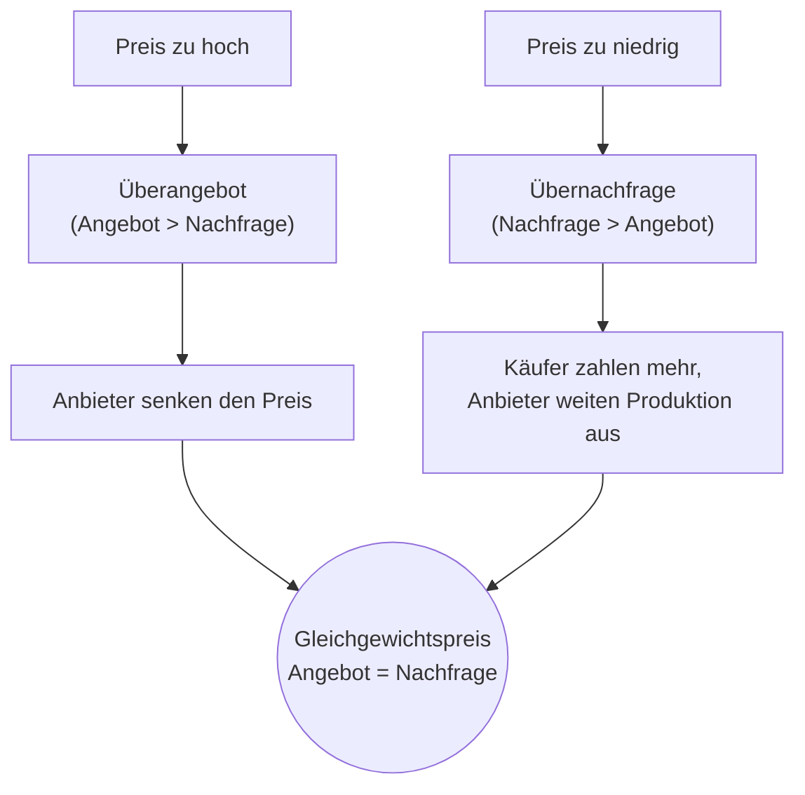

# Markt und Preisbildung

> [!summary] Kurz & knapp
> In der Wirtschaftswissenschaft ist ein **Markt** jedes Zusammentreffen von **Angebot und Nachfrage** – egal ob auf dem Wochenmarkt oder online. Der **Preis** gleicht Angebot und Nachfrage aus: Er pendelt sich dort ein, wo angebotene und nachgefragte Menge gleich sind (**Marktgleichgewicht**). Diesen Ausgleich nennt man **Markt-Preis-Mechanismus**.

## Grundbegriffe

| Begriff | Erklärung |
|---|---|
| **Markt** | Zusammentreffen von Angebot und Nachfrage; nötig sind mind. ein Anbieter, ein Nachfrager und ein Handelsgut |
| **Nachfrage** | alle Käufer, die ein Gut erwerben möchten; je **höher der Preis, desto geringer** die Nachfrage |
| **Angebot** | Summe der Mengen, die alle Anbieter zu verschiedenen Preisen anbieten; je **höher der Preis, desto größer** das Angebot |
| **Überangebot** | Zum aktuellen Preis wird mehr angeboten als nachgefragt → Preis sinkt |
| **Übernachfrage** | Zum aktuellen Preis wird mehr nachgefragt als angeboten → Preis steigt |
| **Marktgleichgewicht** | Angebotene = nachgefragte Menge; der **Gleichgewichtspreis** räumt den Markt |
| **Markt-Preis-Mechanismus** | Ausgleich von Angebot und Nachfrage über den Preis |
| **Gewinn** | Umsatz − Kosten |

## Geld als Tauschmittel

Früher tauschte man Ware gegen Ware. Heute ist **Geld** das allgemein anerkannte Tauschmittel. Dadurch kann man den Tausch „Gut gegen Gut“ **zeitlich trennen**: Man verkauft heute ein Gut (oder seine Arbeit) gegen Geld und kauft erst später mit diesem Geld ein anderes Gut. Man muss also keinen Tauschpartner finden, der genau das eigene Gut will und gleichzeitig das gewünschte Gut hat.

## Der Markt-Preis-Mechanismus

- Im Diagramm fällt die **Nachfragekurve** mit steigendem Preis, die **Angebotskurve** steigt. Im **Schnittpunkt** liegen Gleichgewichtspreis und Gleichgewichtsmenge.
- Der Mechanismus funktioniert am besten im **Polypol** → [[Marktformen]].

> [!tip] Merke
> - **Preis hoch → Angebot ↑, Nachfrage ↓ → Überangebot → Preis sinkt.**
> - **Preis niedrig → Nachfrage ↑, Angebot ↓ → Übernachfrage → Preis steigt.**
> - Im Gleichgewicht wird der Markt **geräumt**.

## Lernfragen
> [!question]- Was versteht man in der Wirtschaftswissenschaft unter einem Markt?
> Das Zusammentreffen von Angebot und Nachfrage nach einem Gut, unabhängig von einem bestimmten Ort.

> [!question]- Was passiert bei einem Überangebot?
> Die Anbieter senken die Preise, bis angebotene und nachgefragte Menge übereinstimmen.

> [!question]- Was ist mit „Geld trennt den Tausch Gut gegen Gut zeitlich“ gemeint?
> Man muss Verkauf und Kauf nicht gleichzeitig mit demselben Partner abwickeln. Man erhält für sein Gut Geld und kauft damit später etwas anderes.

> [!question]- Definiere den Gleichgewichtspreis.
> Der Preis, bei dem die angebotene Menge genau der nachgefragten Menge entspricht. Der Markt wird geräumt.

## Siehe auch
- [[Marktformen]]
- [[Wirtschaftskreislauf]]
- [[Übung Marktspiel und Marktformen]]
