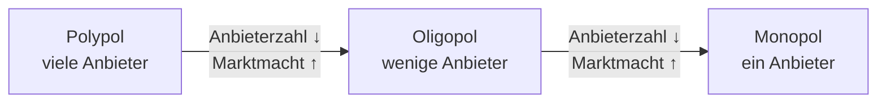

# Marktformen

> [!summary] Kurz & knapp
> Märkte werden nach der **Anzahl der Anbieter** unterschieden: **Polypol** (viele Anbieter), **Oligopol** (wenige Anbieter) und **Monopol** (ein Anbieter). Je weniger Anbieter es gibt, desto größer ist ihre **Marktmacht** und desto schwächer wirkt der Markt-Preis-Mechanismus.

## Die drei Marktformen

| | **Polypol** | **Oligopol** | **Monopol** |
|---|---|---|---|
| Anbieter | sehr viele | wenige | einer |
| Wettbewerb | stark („Wettbewerbsmarkt“) | gegenseitige Abhängigkeit, **Preiskampf** möglich | **kein** Wettbewerb, keine Konkurrenz |
| Preisspielraum des Anbieters | sehr gering | mittel, Reaktion der Konkurrenz beachten | groß – Preis und Menge nahezu frei wählbar |
| Gefahr | – | **Kartellbildung** (Preisabsprachen, in Deutschland verboten) | überhöhte Preise, wenig Innovation |
| Preis | **bestmöglich aus Kundensicht** | schwankend | **bestmöglich für den Anbieter**, **hohe Gewinne** |
| Beispiele | Bäckereien, Obsthändler auf dem Wochenmarkt | Tankstellen, Mobilfunk, Grafikkarten (GPU), Cloud-Anbieter | Deutsche Bahn (Schienennetz), Wasserversorger vor Ort, Patentinhaber |

![[WIPO.pdf#page=70]]

## Erläuterungen

- **Polypol (griech. „viel Verkauf“):** Viele Anbieter verkaufen ein gleiches, austauschbares Produkt. Wer teurer ist, verliert Kunden sofort an die Konkurrenz → der Markt-Preis-Mechanismus wirkt am besten.
- **Oligopol:** Jeder Anbieter hat Marktmacht und beobachtet die anderen. Senkt einer den Preis, ziehen die anderen nach → **Preiskampf**. Andererseits droht ein **Kartell**: Die Anbieter sprechen Preise ab. Das ist in Deutschland verboten; das **Bundeskartellamt** überwacht das.
- **Monopol:** Der Monopolist kann den Preis setzen, muss aber beachten, dass Kunden bei zu hohen Preisen auf **Ersatzprodukte** ausweichen oder ganz verzichten. Er versucht, seine Stellung abzusichern (Image, Exklusivität, Markteintrittsbarrieren).

> [!warning] Korrektur
> In der eigenen Erklärung steht: „Monopol: ein Unternehmen, welches ein gewisses Gut anbietet und den Preis **beliebig** bestimmen kann.“ Ganz beliebig ist der Preis nicht: Auch ein Monopolist ist an die **Nachfrage** gebunden. Steigt der Preis zu stark, kaufen weniger Kunden oder sie weichen auf Ersatzprodukte aus. Er wählt den Preis, der ihm den **höchsten Gewinn** bringt.

> [!tip] Merke
> - **Poly = viele, Oligo = wenige, Mono = einer** (Anbieter).
> - Polypol: Preis **aus Kundensicht** am besten; Monopol: Preis **für den Anbieter** am besten.
> - Oligopol: **Preiskampf** oder **Kartell** (verboten).
> - Marktmacht steigt, je weniger Anbieter es gibt.

## Lernfragen
> [!question]- Woran unterscheidet man Polypol, Oligopol und Monopol?
> An der Anzahl der Anbieter: viele, wenige oder einer.

> [!question]- Warum kann ein Anbieter im Polypol kaum höhere Preise verlangen?
> Weil viele Konkurrenten ein gleichartiges Produkt anbieten. Die Kunden wechseln sofort zum günstigeren Anbieter.

> [!question]- Was ist ein Kartell und warum ist es verboten?
> Eine Gruppe von Anbietern, die Preise oder Mengen absprechen. Das schaltet den Wettbewerb aus und schadet den Kunden durch zu hohe Preise.

> [!question]- Welche Marktform liegt bei Grafikkarten für PCs vor? Begründe.
> Ein Oligopol: Es gibt nur wenige Hersteller von Grafikchips bei großer Nachfrage. Jeder hat Marktmacht und reagiert auf die Preise der anderen.

> [!question]- Ordne zu: „Kartellbildungsgefahr“, „Keine Konkurrenz“, „Viele Konkurrenten“.
> Kartellbildungsgefahr → Oligopol; keine Konkurrenz → Monopol; viele Konkurrenten → Polypol.

## Siehe auch
- [[Markt und Preisbildung]]
- [[Übung Marktspiel und Marktformen]]
