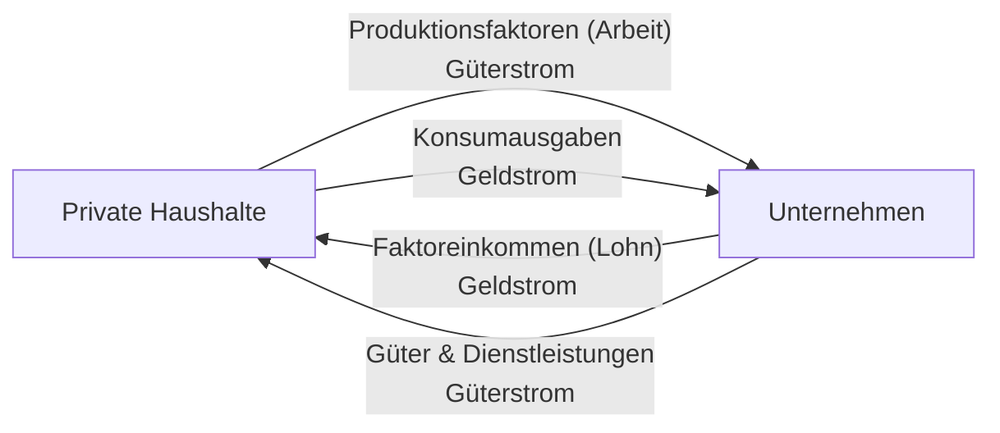
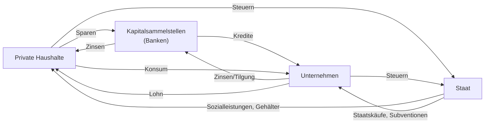

# Wirtschaftskreislauf

> [!summary] Kurz & knapp
> Der Wirtschaftskreislauf ist ein Modell der Volkswirtschaft: Die Teilnehmer werden zu **Sektoren** zusammengefasst (private Haushalte, Unternehmen, Kapitalsammelstellen/Banken, Staat). Zwischen ihnen fließen **Güterströme** und gleich große, entgegengesetzte **Geldströme**. Die Ausgaben des einen sind die Einnahmen des anderen.

## Einfacher Wirtschaftskreislauf (2 Sektoren)

- **Private Haushalte** stellen den Unternehmen **Produktionsfaktoren** zur Verfügung (v. a. Arbeit) → Güterstrom.
- Dafür erhalten sie **Faktoreinkommen** (Lohn, Gehalt) → Geldstrom.
- Mit dem Einkommen kaufen sie **Güter und Dienstleistungen** der Unternehmen → Güterstrom.
- Dafür zahlen sie die **Konsumausgaben** → Geldstrom zurück zu den Unternehmen.

| Begriff | Bedeutung |
|---|---|
| **Produktionsfaktor** | alle Güter und Leistungen, die für die Produktion nötig sind (z. B. Arbeit, Boden, Kapital, Bildung, Know-how) |
| **Faktoreinkommen** | Einkommen der Haushalte für die Bereitstellung von Produktionsfaktoren (Lohn, Miete, Zinsen) |
| **Güterstrom** | Fluss von Waren, Dienstleistungen oder Produktionsfaktoren |
| **Geldstrom** | Gegenleistung in Geld (Gegenrichtung zum Güterstrom) |

**Beispiel aus dem Unterricht (Max’ Geldschein):** Max kauft mit seinem Taschengeld ein T-Shirt (Konsum) → das Geschäft zahlt damit u. a. Löhne (Faktoreinkommen) → ein Elternteil erhält Lohn → Max bekommt wieder Taschengeld. So kann derselbe Geldschein zurückkommen.

## Erweiterter Wirtschaftskreislauf

- **Kapitalsammelstellen (Banken):** Haushalte **sparen** einen Teil ihres Einkommens bei Banken und erhalten **Zinsen**. Die Banken geben das Geld als **Kredite** an Unternehmen für **Investitionen**, die dafür Zinsen zahlen.
- **Staat:** erhält **Steuern** von Haushalten und Unternehmen und gibt sie für Staatseinkäufe, Subventionen und **Sozialleistungen** (z. B. Kindergeld) wieder aus. Er legt Geld bei Banken an oder nimmt Kredite auf.
- (Im vollständigen Modell kommt noch das **Ausland** – Export/Import – hinzu.)

> [!tip] Merke
> - **Güterstrom und Geldstrom laufen immer entgegengesetzt.**
> - Haushalte → Unternehmen: **Arbeit** und **Konsumausgaben**; Unternehmen → Haushalte: **Güter** und **Einkommen**.
> - Banken verbinden **Sparen** (Haushalte) und **Investieren** (Unternehmen).
> - Staat: **Steuern** rein, **Transferleistungen/Staatskäufe** raus.

## Lernfragen
> [!question]- Welche Ströme fließen im einfachen Wirtschaftskreislauf?
> Güterströme (Arbeit von Haushalten zu Unternehmen, Güter von Unternehmen zu Haushalten) und Geldströme (Einkommen zu Haushalten, Konsumausgaben zu Unternehmen).

> [!question]- Was ist ein Faktoreinkommen?
> Das Einkommen, das Haushalte für die Bereitstellung von Produktionsfaktoren bekommen, z. B. Lohn für Arbeit.

> [!question]- Welche Rolle spielen Banken im erweiterten Kreislauf?
> Sie sammeln die Ersparnisse der Haushalte (und zahlen Zinsen) und vergeben Kredite an Unternehmen für Investitionen (gegen Zinsen).

> [!question]- Ordne zu: „Ein Azubi erhält Kindergeld.“
> Geldstrom vom Staat zu den privaten Haushalten (Transferleistung).

> [!question]- Warum spricht man von einem „Tauschprozess“?
> Jeder Geldzahlung steht eine Gegenleistung (Gut, Arbeit) gegenüber. Die Ausgaben des einen sind die Einnahmen des anderen.

## Siehe auch
- [[Markt und Preisbildung]]
- [[Übung Wirtschaftskreislauf - Viba GmbH]]
- [[Güterarten]]
